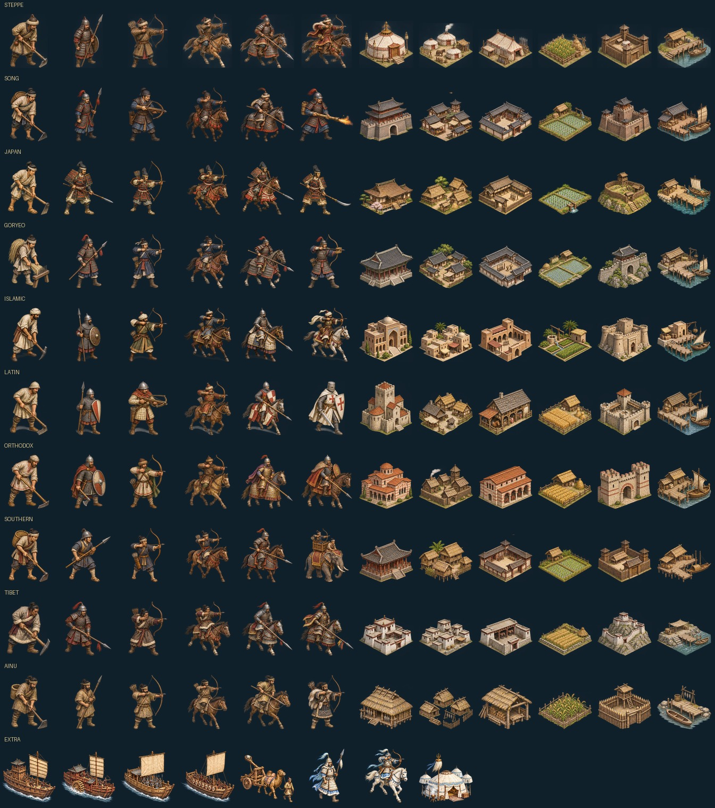

# モンゴル帝国 — ユーラシア統一への道（YYMongolia）

Rust で作った Age of Empires 風のリアルタイムストラテジーです。**ブラウザ版**と **Windows 版**を、同じリポジトリの同じゲーム本体から作ります。
[YYEmpire（春秋戦国）](https://github.com/ykwyuta/yyempire)・[YYEmpire Windows 版](https://github.com/ykwyuta/yyempire-win) と同じゲームエンジン（シミュレーション・AI・UI・描画層）を土台に、
舞台を 1115〜1294 年のユーラシア大陸に移し、モンゴル帝国の時代の国々・兵種・英霊・史実の出来事を作り直しました。

- **ブラウザ版**：WebAssembly にコンパイルし、WebGL2 と Canvas2D で描画する。外部クレートは使わない。静的サイトとして Cloudflare（Workers の静的アセット／Pages）で公開できる。
- **Windows 版**：Direct3D11 / Direct2D / DirectWrite で描画する。UI フレームワークやゲームエンジンは使わず、`windows` クレート（Win32 API バインディング）だけで描画・入力を作る。

**ドキュメント**：紹介とユーザーガイド（[日本語](docs/ja/introduction.md)・[English](docs/en/introduction.md)・[中文](docs/zh/introduction.md)）。



## 遊ぶ・ビルドする

WebGL2 に対応したブラウザで、公開したサイトを開くだけで遊べます。

```
bash build.sh                      # Rust が無ければ rustup で導入し、dist/ に静的サイトを出力
cd dist && python3 -m http.server 8000
```

ブラウザで http://localhost:8000/ を開く。

### Windows 版

Windows で：

```
cargo run --release --bin yymongolia-win
```

`target/release/yymongolia-win.exe` ができる（アイコン入り）。GitHub Actions の `windows` ジョブも exe を成果物（yymongolia-windows）として保存する。

- 表示言語は `%APPDATA%\yymongolia\settings.txt` に保存する（初回は Windows の表示言語に合わせる）。
- 記録は `%APPDATA%\yymongolia\saves\slot{N}.yymsav`。「書き出す」「ファイルから読み込む」はファイルダイアログを使う。ブラウザ版と同じ形式なので、互いに持ち運べる。
- 異常終了したときは `%APPDATA%\yymongolia\logs` に調査ログ（パニック・例外・応答なし・メモリの推移）を残し、対局中ならその時点の記録も残す。
- 文字が小さいときは Ctrl＋＋／Ctrl＋−、F11 で全画面。画面の解像度に合わせて UI は自動で拡大される。

### Cloudflare への公開

- **Workers（静的アセット）**：`bash build.sh && npx wrangler deploy`（設定は `wrangler.toml`）
- **Pages／Workers Builds（Git 連携）**：ビルドコマンド `npm run build`（中身は `bash build.sh`）、出力ディレクトリ `dist`

`dist/` は `index.html`・`main.js`・`yymongolia.wasm` などだけで、画像などの素材は wasm に埋め込まれている。

## ゲームの特徴

- **舞台**：1115年（金の建国）〜1294年（クビライの死）のユーラシア。東はサハリン・日本から西はポーランド・ハンガリー・エジプトまで、34か国を史実のおおよその位置（経緯度）に配置。海岸線・湖・大河は Natural Earth（パブリックドメイン）のデータから作り、ヒマラヤ・天山・アルタイ・カフカスなどの山脈、ゴビ・タクラマカン・アラビアなどの砂漠、北のタイガ、ユーラシアの大草原を再現した。
- **共通の時間軸**：時間はマップ全体で共有（群雄割拠の時代は1年＝24秒、1206年の大モンゴル国の成立からは1年＝48秒）。
- **国ごとに違う兵種**：歩兵・弓兵・騎兵・船の大分類の上に、国（文化）ごとの兵種がある。モンゴルの騎射兵・ケシク、宋の神臂弓兵・火槍兵・楼船、金の鉄浮屠・拐子馬、西夏の鉄鷂子・潑喜、日本の武士・騎馬武者・和弓兵、高麗の片箭兵、エジプトのマムルーク、ビザンツのヴァリャーグ親衛隊・カタフラクト、ポーランド・ハンガリーの騎士、大理・大越の戦象、骨嵬のアイヌの狩人など、全40種。騎射兵は騎兵でありながら遠くから射る。
- **服属**：他国が築いた城邑を攻め落として領すると、その国が服属し、その国の兵も自国の兵営で作れる（城邑は築いた国を覚えている）。
- **船と海**：海を渡るには船が要る。船を造れるのは日本・高麗・宋・南宋だけ（それらの城邑を服属させた国も造れる）。海辺に港を建てて船を造り、兵6人を乗せて敵の岸へ上陸させる。船は遠くから矢を射て戦い、沈めば乗っていた兵も失われる。日本の近海には神風（1274年・1281年）が吹く。AI も船を造って海を渡る。
- **邑の破壊**：自国の邑を焼き払って戦利品を得られる（他国が築いた邑ほど多い）。モンゴルなどの遊牧国家の AI は、攻め落とした邑を焼き払うことがある。
- **国の盛衰**：宋は始まりは世界一の富強国（生産×1.75）だが、1127年の靖康の変で北を金に奪われて南宋となり、端平入洛・襄陽の陥落・臨安の開城で弱っていく。モンゴルは始まりは小さな部族連合（生産×0.75）だが、テムジンの登場（1189年）、タタル・ケレイト・ナイマン・メルキトの服属、チンギス・カンの即位（1206年）で強大になる。
- **史実の出来事（119件）**：金の建国、遼の滅亡と西遼の建国、靖康の変、岳飛、ヒッティーンの戦い、壇ノ浦と鎌倉幕府、第四回十字軍、チンギス・カンの即位、オトラル事件、カルカ河畔の戦い、レグニツァとモヒ、バグダードの陥落、アイン・ジャールート、元寇（文永・弘安の役）、厓山、白藤江など。服属（併合）・新しい国の成立・国力の変化・神風といった効果がある。
- **英霊モード（オプション）**：民を生贄に捧げて、モンゴル帝国の時代に各国に実在した将軍・帝王47人の英霊を国を超えて呼べる（チンギス・カン、スブタイ、ジェベ、クビライ、岳飛、韓世忠、完顔阿骨打、北条時宗、源義経、陳興道、サラディン、バイバルス、リチャード獅子心王、タマル女王、アレクサンドル・ネフスキーなど）。
- **テングリの降臨**：1294年までにユーラシアを統一できなければ、永遠の蒼き天（テングリ）がモンゴルに降臨し（滅んでいてもカラコルムに蘇る）、10年でユーラシアを統一して強制的にゲームオーバーとなる。英霊モードでは、英霊だけが天の兵を傷つけられ、降臨から10年後の版図が天のモンゴルより広ければ勝利。
- **国の特徴**：千戸制・駅伝制（モンゴル）、世界一の富・文治主義（宋）、猛安謀克（金）、山城と海島（高麗）、島国の武士（日本）、テオドシウスの城壁（ビザンツ）、カリフの権威（アッバース朝は1258年まで滅びない）など。
- **交易（F4）**：国に属さない商人が諸国を巡る。遠方の商人は海の道（江南・華南）・インドの道・地中海の道・琥珀の道（バルト）の先に来る。オイラト・キルギス・トルクメン・ニザール派・ベドウィン・リトアニアなどの部族は略奪に来るか、傭兵として雇える。
- そのほか、YYEmpire と同じく、少数精鋭（訓練・教化）、維持費、兵⇔民の転換、建設の予約、要塞、反〇〇同盟（隣国の同盟）、戦場の霧、指揮中の一時停止、史記（F3）、記録（F5）、チュートリアル（モンゴルで開始）、日本語・英語・中国語の表示、タッチ操作に対応。

## 記録（セーブ・ロード）

F5（または画面右上の「記録 F5」）で記録画面を開く。3枠の手動記録と、10年ごとの自動記録がある。記録はブラウザの IndexedDB に保存される。別の端末へ移すときは「書き出す」でファイル（.yymsav）にする。

## 構成

| ファイル | 内容 |
|---|---|
| `src/geo.rs` | 地図の範囲・地形生成（山脈・砂漠・草原・森林・古道・海峡）、国家データ |
| `src/geodata.rs` | 海岸線・湖・河川（`tools/geoprep.py` が Natural Earth から生成） |
| `src/world.rs` | シミュレーション：ユニット、建物、経済、戦闘、外交、移動（陸と海） |
| `src/world/units.rs` | 兵種の表と国ごとの兵種、服属による兵種の解放 |
| `src/world/naval.rs` | 船：乗船・上陸 |
| `src/world/conquest.rs` | 邑の破壊、服属（併合）、新しい国の成立、靖康の変、神風 |
| `src/world/history.rs` | 史実年表（`tools/gendata.py` が生成）と君主家、その効果 |
| `src/world/traits.rs` | 国ごとの史実に基づく特徴 |
| `src/world/heroes.rs` | 英霊モード：英霊の一覧、生贄による召喚、AI の召喚 |
| `src/world/descent.rs` | テングリの降臨（モンゴルの復活、天の軍、10年での統一と勝敗） |
| `src/world/trade.rs` | 交易：商人・遠方の商人・部族（略奪・交易・傭兵） |
| `src/i18n.rs` | データの英語・中国語訳（`tools/gendata.py` が生成） |
| `src/ai.rs` | コンピュータ国家の思考（港と船による渡海作戦を含む） |
| `src/game.rs` ほか `src/game/*` | 画面、入力、HUD、外交・ヘルプ・史記・交易・英霊・記録・チュートリアル（両方の版で共通） |
| `src/art.rs` | アイコン・肖像・船と港の絵（手続き的に描く） |
| `src/lib.rs` | ゲーム本体と、版ごとの描画・入力のつなぎ目の切り替え（Windows なら `src/win/*`、それ以外はブラウザ版） |
| `src/web.rs`・`src/gfx.rs`・`src/platform.rs`・`web/` | ブラウザ版：WebGL2 / Canvas2D の描画、IndexedDB の記録、入力 |
| `src/main.rs`・`src/win/app.rs` | Windows 版：実行ファイルの入口と Win32 のメッセージループ |
| `src/win/gfx.rs` | Windows 版：Direct3D11（地形テクスチャ・図形）と Direct2D/DirectWrite（文字・UI） |
| `src/win/platform.rs` | Windows 版：記録・設定の置き場所（%APPDATA%）とファイルダイアログ |
| `src/win/crashlog.rs` | Windows 版：異常終了の調査ログ |
| `build.rs` | Windows（MSVC）版の exe にアイコンを埋め込む |

## データの作り直し

```
python3 tools/geoprep.py <Natural Earth の geojson のあるディレクトリ> src/geodata.rs
python3 tools/gendata.py           # 史実年表と訳の辞書を作り直す
```

## テスト

```
cargo test --release --lib -- --skip long_sim             # 単体テスト
SIM_YEARS=60 cargo test --release long_sim -- --nocapture  # 全国 AI で60年分をヘッドレスで回す
```

## 出典

地図の海岸線・湖・河川は [Natural Earth](https://www.naturalearthdata.com/)（パブリックドメイン）の 1:50m データを簡略化したもの。
ゲームエンジンの土台は [YYEmpire](https://github.com/ykwyuta/yyempire)・[YYEmpire Windows 版](https://github.com/ykwyuta/yyempire-win) のもの。

## アートとデザイン

兵士・建築はモンゴル帝国期の10文化圏に合わせた生成画像に刷新。軍船・戦象・英霊も専用画像を使用し、UIは蒼天と濃紺の織物を基調とする。[制作方針・文化圏の対応・再変換手順](docs/art-direction.md)を参照。
